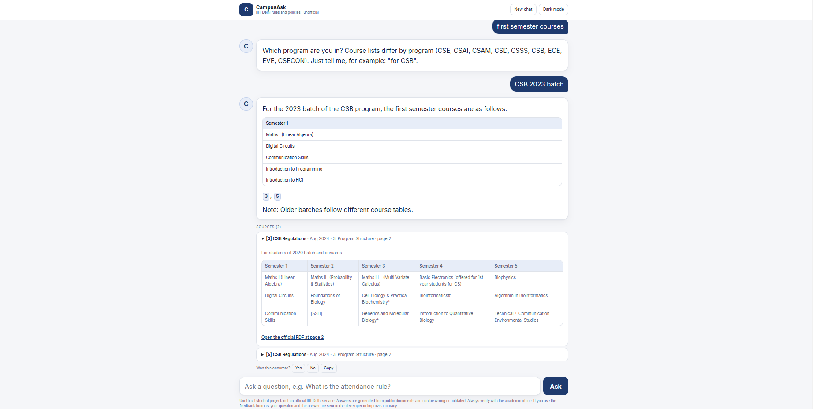

# CampusAsk

Cited answers to questions about IIIT Delhi's academic rules, drawn only from the official public documents. Every answer shows the document, version, section and page, with a link to the PDF at that page, so it can be checked.

**Live demo:** https://campusask.onrender.com (free hosting: the first request after a quiet period can be slow)

> Unofficial student project, not affiliated with IIIT Delhi. It can be wrong or out of date. Always verify with the academic office.

## What it does
- Answers questions such as "What happens if I get two F grades in consecutive semesters?" or "What are the first semester courses?" with numbered citations and source panels.
- Handles informal questions, typos and Hinglish in my tests.
- Understands follow-ups ("what about CSE?", "make a table") and asks which program you are in when a question depends on it.
- Applies the rules to a student's own numbers (credits, CGPA, planned load) without promising outcomes, and tells the student to confirm with the academic office or their degree audit.
- Plans a target CGPA: the arithmetic is done in Python, not by the language model.
- Says "I could not find this in the documents" instead of guessing.

## Documents indexed
UG Regulations (Oct 2025), B.Tech Ordinances, the regulations of nine programs (CSE, CSAI, CSAM, CSD, CSSS, CSB, ECE, EVE, CSECON) and the Evaluation Policy (copied from a web page). About 300 chunks in total. Version-history pages are excluded so superseded rules are not quoted. Sources are listed in `data/sources.csv`. Only public documents are used; nothing behind a login.

## How it works
1. **Ingest** (`scripts/ingest.py`): PDFs become chunks of about 800 characters (150 overlap) that keep title, version, URL, page and section heading. The letterhead is stripped.
2. **Curriculum tables:** PyMuPDF garbled the course tables (merged cells, rows split across a page break). Those pages are transcribed from page images with Gemini, saved in `data/tables/`, rejoined across page breaks, and indexed whole with their batch caption. I verified the CSB tables against the PDF; the other programs' tables have not all been checked line by line. When no year is asked, the newest batch is preferred.
3. **Search:** BM25 over stemmed tokens, with a small synonym list, typo correction against the documents' own vocabulary, and normalisation such as "1st" to "first". A program named in the question boosts that program's regulation. If a rule continues in the next chunk, that chunk is added.
4. **Relevance:** a loose keyword gate drops clearly unrelated questions; the model decides whether the retrieved text answers the question, and a reply without a citation counts as "not found".
5. **Answer:** the top chunks go to a Gemini Flash-Lite model that must use only those sources. If it hits a quota or error, the next configured model is tried within a 40-second budget; otherwise the relevant passages are shown on their own.
6. **Planner** (`app/planner.py`): for "what SGPA do I need" questions the model only extracts the numbers as JSON; the required SGPA and the grade mix (whole courses) are computed in Python and given back as a verified block.
7. **UI:** one HTML/JS file: chat thread, light and dark theme, rendered tables, clickable citation badges, source panels linking to the PDF page.

Stack: Python 3.12, FastAPI, PyMuPDF, rank-bm25, snowballstemmer, Gemini API, Render (free tier), UptimeRobot. Locally, sentence-transformers (`all-MiniLM-L6-v2`) can be used for hybrid search; production runs keyword-only.

## Evaluation
I wrote question sets and measured retrieval instead of eyeballing it. `hit@k` means a chunk from the correct page (or containing a phrase that proves the answer) is in the top k. Numbers are for the keyword search used in production.

| Set | Answerable questions | hit@1 | hit@3 |
|---|---|---|---|
| Dev | 35 | 86% | 97% |
| Test (written after the dev set) | 15 | 93% | 100% |
| Informal wording and typos | 17 | 88% | 94% |
| Very short questions | 9 | 89% | 100% |
| Program-specific | 7 | 57% | 100% |

- **Refusals:** 26 distinct unanswerable questions (hostel, fees, placements, cricket and so on) were all refused.
- **Answer quality:** on the 15-question test set, 15/15 answers were graded correct and 5/5 unanswerable questions were refused. I graded them by hand against the PDFs, before the program regulations were added.
- **Method comparison** (hit@3, dev / test / informal, multi-document corpus): keyword 100 / 100 / 94, hybrid 97 / 93 / 88, semantic 83 / 93 / 76.
- **Deterministic tests** (no model calls): `chat_check` (follow-ups, branch handling, small talk, table cleaning) and `planner_check` (CGPA maths) both pass.
- **CGPA planner:** the same planning question gave the same required SGPA (5.29) in three runs; an unreachable target was reported as unreachable.
- **Real users:** not measured yet.
- **Caveats:** The sets are small and written by me. An early audit of the answer key fixed incorrect page labels before reporting the numbers above (see `docs/DEVLOG.md`).

## Design decisions
- **Keyword search in production.** Keyword search matched or beat hybrid and semantic search on my sets, and the free host has 512 MB of RAM, which cannot hold the embedding model.
- **Loose relevance gate.** BM25 scores depend on question length, so a short valid question scored below an off-topic one with a single rare-word match; no threshold separated them. The gate only drops questions with no match and the model judges the rest (26/26 refusals).
- **Maths in code.** The model gave 5.29 in one run and 5.24 in the next for the same question, so the arithmetic moved to Python.
- **Free-tier limits shape the design.** My first model allowed 20 requests a day. I switched models, then added a cache, a per-IP rate limit, model fail-over and a passages-only fallback.
- **Model names live in configuration**, because models get retired.

## Known limitations
- Two targets in one question (for example CGPA 5.2 and 5.3) can give a wrong figure for one of them (7.65 instead of about 7.33 for 5.3).
- The planner does not handle fixed grades ("one course is a D, what do I need in the rest?").
- A follow-up like "same conditions" after a clarifying question can be refused.
- Free-tier model quota can cause occasional passages-only answers.
- Not indexed yet: hostel rules, fee structure, academic dishonesty policy, minor regulations, academic calendar.
- Keyword search misses paraphrases that share no words with the document.
- Answers are generated and can contain mistakes. Verify with the source link.

## Run locally
    python -m venv .venv
    .venv\Scripts\activate
    pip install -r requirements.txt
    # put the PDFs listed in data/sources.csv into data/raw, then:
    python scripts/ingest.py
    python scripts/build_index.py
    # create .env with GEMINI_API_KEY, GEMINI_MODEL and (optional) GEMINI_FALLBACK_MODELS
    uvicorn app.main:app --reload

Set `LITE=1` to run the production-style keyword-only mode. Checks: `python -m scripts.check_all`, `python -m scripts.refusal_check`, `python -m scripts.chat_check`, `python -m scripts.planner_check`.

## Repository layout
- `app/`: FastAPI app (`main.py`), `pipeline.py`, `retrieval.py`, `llm.py`, `planner.py`, `static/index.html`
- `scripts/`: ingestion, table transcription, evaluation and diagnostic scripts
- `data/`: `sources.csv`, transcribed tables, processed chunks (PDFs are not committed)
- `eval/`: question sets and results
- `docs/DEVLOG.md`: the full story, including what broke

## How this was built
I designed the pipeline, wrote the evaluation sets, verified answers against the official PDFs, debugged retrieval and chat failures, and deployed the app on Render. Development decisions and failure stories are documented in `docs/DEVLOG.md`. I am reviewing the codebase module by module so I can explain every part.

## Next
Add the missing documents, measure accuracy on questions from real students, and handle fixed-grade constraints in the planner.