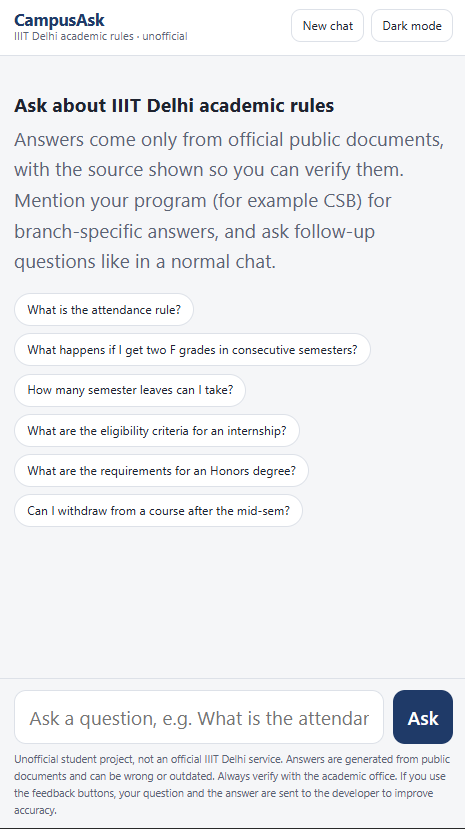

# CampusAsk


Cited answers to questions about IIIT Delhi's academic rules and campus policies, drawn only from official public documents. Every answer shows the document, version, section and page, with a link to the PDF at that page, so it can be checked.

**Live demo:** https://campusask.onrender.com

> Unofficial student project, not affiliated with IIIT Delhi. It can be wrong or out of date. Always verify with the academic office.

<p align="center">
  
  
</p>

## What it does
- Answers questions such as "What happens if I get two F grades in consecutive semesters?", "What are the first semester courses?" or "What is the fine for unauthorized parking?" with numbered citations and source panels.
- Handles informal questions, typos and Hinglish in my tests.
- Understands follow-ups ("what about CSE?", "make a table") and asks which program you are in when a question depends on it.
- Applies the rules to a student's own numbers (credits, CGPA, planned load) without promising outcomes, and tells the student to confirm with the academic office or their degree audit.
- Plans a target CGPA, including several targets in one question and courses whose grade is already known: the arithmetic is done in Python, not by the language model.
- Says "I could not find this in the documents" instead of guessing.
- Feedback buttons (accurate / not accurate / "should have been found") feed a loop that turns negative feedback into candidate test questions.

## Documents indexed
UG Regulations (Oct 2025), B.Tech Ordinances, the regulations of nine programs (CSE, CSAI, CSAM, CSD, CSSS, CSB, ECE, EVE, CSECON), the Evaluation Policy and the 2025-26 fee schedule (both copied from web pages), and campus policies: Hostel Rules and Allotment, Hostel Management, Campus Discipline and Fine Policy, Student Conduct, Policy against Ragging and the Academic Dishonesty Policy. About 380 chunks. "Change history" sections are left out while the rules above them stay. Sources are listed in `data/sources.csv`. Only public documents are used; nothing behind a login.

Not indexed (no document found yet): academic calendar, scholarships, certificate procedures (bonafide, transcripts), timetables.

## How it works
1. **Ingest** (`scripts/ingest.py`): PDFs become chunks of about 800 characters (150 overlap) that keep title, version, URL, page and section heading. The letterhead is stripped.
2. **Curriculum and fine tables:** PyMuPDF garbled the course tables (merged cells, rows split across a page break). Those pages are transcribed from page images with Gemini, saved in `data/tables/`, rejoined across page breaks in code, and indexed whole with their batch caption. I verified the CSB tables against the PDF; the other programs' tables have not all been checked line by line.
3. **Search:** BM25 over stemmed tokens with a small synonym list, typo correction against the documents' own vocabulary, and normalisation such as "1st" to "first". A program named in the question boosts that program's regulation, and the newest batch's table is preferred unless a year is asked. Campus-policy files are down-weighted for questions that do not use campus vocabulary. If a rule continues in the next chunk, that chunk is added.
4. **Relevance:** a loose keyword gate drops clearly unrelated questions; the model decides whether the retrieved text answers the question, and a reply without a citation counts as "not found".
5. **Answer:** the top chunks go to a Gemini Flash-Lite model that must use only those sources. On a quota error or timeout the next configured model is tried within a 45-second budget. If a model refuses, the other model gets one second opinion (a cited answer is accepted); refusals are never cached. If nothing answers, the relevant passages are shown on their own.
6. **Planner** (`app/planner.py`): for "what SGPA do I need" questions the model only extracts the numbers as JSON (current CGPA, credits, one or several targets, grades already known); the required SGPA for each target and the grade mix, in whole courses, are computed in Python and given back as a verified block.
7. **UI:** one HTML/JS file: chat thread, light and dark theme, rendered tables, clickable citation badges, source panels linking to the PDF page, feedback buttons.

Stack: Python 3.12, FastAPI, PyMuPDF, rank-bm25, snowballstemmer, Gemini API, Render (free tier), UptimeRobot, GitHub Actions. Locally, sentence-transformers (`all-MiniLM-L6-v2`) can be used for hybrid search; production runs keyword-only.

## Evaluation
I wrote question sets and measured retrieval and answers instead of eyeballing them. `hit@k` means a chunk from the correct page (or containing a phrase that proves the answer) is in the top k. Numbers are for the keyword search used in production; the model sees six to eight chunks.

| Set | Answerable questions | hit@1 | hit@3 | hit@6 |
|---|---|---|---|---|
| Dev | 37 | 78% | 100% | 100% |
| Test (written after the dev set) | 15 | 93% | 100% | 100% |
| Informal wording and typos | 18 | 89% | 94% | 94% |
| Very short questions | 11 | 82% | 100% | 100% |
| Program-specific | 7 | 86% | 100% | 100% |

hit@1 is lower than hit@3 because some rules exist twice (the Evaluation Policy repeats the UG grading table); the model sees several chunks, so this rarely changes the answer.

- **Refusals:** 22 distinct unanswerable questions (hostel Wi-Fi, library hours, placements, cricket and so on): 21 refused, 1 answered by saying the policy does not state it.
- **Answer-level check** (`python -m scripts.answer_eval`, automated substring rules, 19 fact questions and 3 refusals, facts taken from the PDFs): 22 of 22 passed. Crude, and a pass is not proof. It caught a real bug: a CGPA-planning rule fired on "minimum CGPA required for Honors" and the question was refused.
- **Common student questions** (15, including six that a friend asked): 11 answered with citations (not each graded against the PDFs), 4 refused (bonafide certificate, provisional transcript, scholarships, fee refund policy; the documents mention refunds only for the security deposit, hostel sharing and semester leave).
- **Deterministic tests** (no model calls, run in CI on every push): `chat_check`, `planner_check` (several targets, a known grade, unreachable targets), `failover_check`, and a retrieval gate that fails the build if hit@3 drops below 90% on any set.
- **Real users:** not measured yet. The app collects ratings; `scripts/feedback_report.py` summarises them.
- **Caveats:** the sets are small and written by me. My first run scored 32% hit@3 on the dev set; an audit showed 21 of the 27 misses were wrong page labels in my own questions, not retrieval failures (see `docs/DEVLOG.md`).

## Design decisions
- **Keyword search in production.** Keyword search matched or beat hybrid and semantic search on my sets (hit@3 on dev / test / informal, when twelve documents were indexed: keyword 100 / 100 / 94, hybrid 97 / 93 / 88, semantic 83 / 93 / 76), and the free host has 512 MB of RAM, which cannot hold the embedding model.
- **Loose relevance gate.** BM25 scores depend on question length, so a short valid question scored below an off-topic one with a single rare-word match; no threshold separated them. The gate only drops questions with no match and the model judges the rest.
- **Maths in code.** The model gave 5.29 in one run and 5.24 in the next for the same question, so the arithmetic moved to Python.
- **Second opinion on refusals.** A model sometimes refuses a question its sources answer; asking the other model once recovers many of them, at the cost of a few extra seconds on real refusals.
- **Free-tier limits shape the design.** My first model allowed 20 requests a day. I switched models, then added a cache, a per-IP rate limit, model fail-over with a time budget and a passages-only fallback.
- **Model names live in configuration**, because models get retired.

## Privacy
Questions are answered statelessly. If a student presses a feedback button, the question, the answer and an optional note are stored for the developer (in a file on the server, in the host's logs and, if configured, in a private channel). No IP address or account is stored. The feedback export is protected by a secret key.

## Known limitations
- The planner's numbers come from a model reading the question; a badly worded question can fail extraction, and the answer then falls back to the model's own working, which can be wrong. Check the arithmetic.
- A follow-up like "same conditions" after a clarifying question can still be refused.
- A refused question can take up to about 30 seconds, because a second model is asked.
- Free-tier model quota can cause occasional passages-only answers.
- Not indexed: academic calendar, scholarships, certificate procedures.
- The fines table is cited as page 1 although it spans five pages.
- Keyword search misses paraphrases that share no words with the document.
- Feedback is kept in a file on the free host, which is wiped on restart; if a private webhook is configured, a copy is also sent there.
- Answers are generated and can contain mistakes. Verify with the source link.

## Run locally
```
python -m venv .venv
.venv\Scripts\activate
pip install -r requirements.txt
# put the PDFs listed in data/sources.csv into data/raw, then:
python scripts/ingest.py
python scripts/build_index.py
# create .env with GEMINI_API_KEY, GEMINI_MODEL and (optional) GEMINI_FALLBACK_MODELS
uvicorn app.main:app --reload
```
Set `LITE=1` to run the production-style keyword-only mode. Checks: `python -m scripts.chat_check`, `planner_check`, `failover_check`, `check_all`, `answer_eval`, `refusal_check`.

## Repository layout
- `app/`: FastAPI app (`main.py`), `pipeline.py`, `retrieval.py`, `llm.py`, `planner.py`, `static/index.html`
- `scripts/`: ingestion, table transcription, evaluation and diagnostic scripts
- `data/`: `sources.csv`, transcribed tables, processed chunks (PDFs are not committed)
- `eval/`: question sets and results
- `.github/workflows/ci.yml`: deterministic tests and the retrieval gate
- `docs/DEVLOG.md`: the full story, including what broke

## License
MIT. See `LICENSE`.

## How this was built
I designed and built this project myself, with help from AI assistants for drafting code, debugging, and exploring design options. I wrote the evaluation sets, checked answers against the official PDFs, fixed the failures recorded in `docs/DEVLOG.md`, and made the final design decisions (keyword search in production, maths in Python, second opinion on refusals, and the evaluation harness). I am going through the code module by module so I can explain every part.

## Next
Index the missing documents, measure accuracy on questions from real students, and handle fixed-grade constraints in the planner.